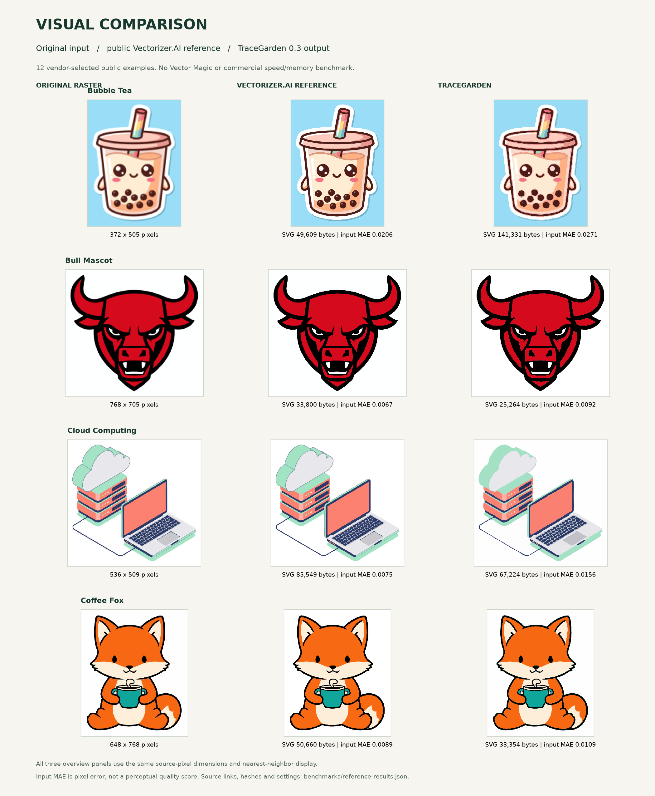
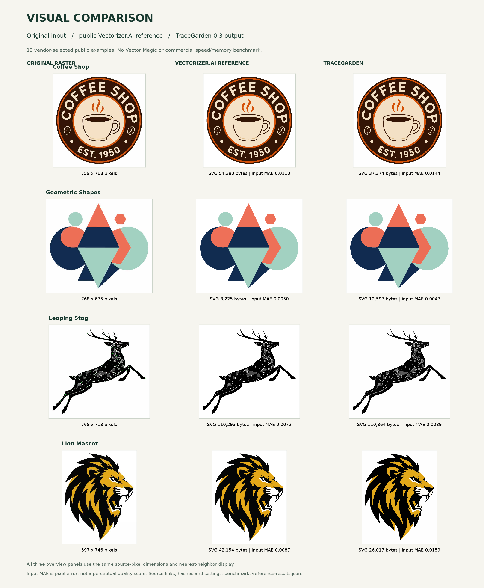
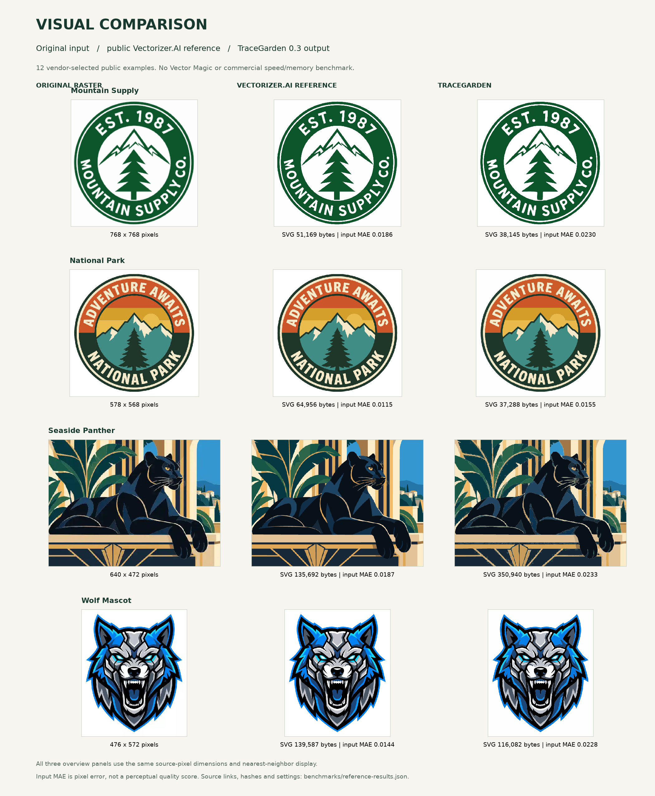
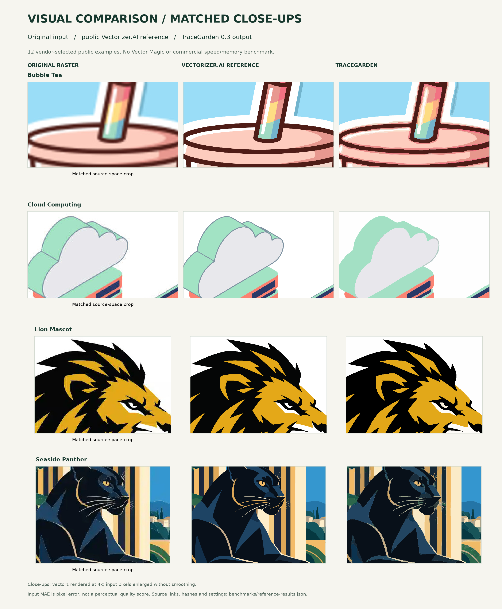

# TraceGarden

[](https://github.com/DylanMartinLSC/TraceGarden/actions)

A free, open-source image-to-vector studio that runs on your computer's CPU. No account, cloud uploads, GPU, telemetry or runtime internet connection.

**0.3.0: full workflow coverage.** Conversion, geometry, background correction, editing, projects, native integration and all ten exports are implemented and tested. Reconstruction quality is measured separately. See [feature coverage and limitations](FEATURES.md), [benchmarks](benchmarks/README.md) and [changes](CHANGELOG.md).

## Development status

Version 0.3 implements the advertised desktop conversion/edit/export workflows tracked in [PARITY.md](PARITY.md). Native package, installer and clipboard acceptance checks have passed on Windows, macOS ARM/Intel and Linux. Reconstruction differences and benchmark limits are documented; feature coverage is not a claim to duplicate a proprietary engine.

The current source checkout also includes selectable **High Quality** conversion. Restart an already running source installation after updating. This addition is unreleased; existing 0.3.0 downloads do not contain the new selector.

## Start

Download your platform's package from [Releases](https://github.com/DylanMartinLSC/TraceGarden/releases). Windows: run the Setup installer, then open TraceGarden from the Start menu. The portable ZIP also works: extract the whole folder and open `TraceGarden.exe`, keeping `_internal` beside it. macOS: open the disk image and drag TraceGarden to Applications; choose Apple Silicon or Intel for your Mac. Linux: make the AppImage executable in its file properties and open it. Python is bundled in these packages. Builds are unsigned, so your operating system may show an approval prompt. Earlier releases do not contain all 0.3 features.

From source on Windows: install Python 3.11+, run **Install TraceGarden.cmd**, then **Start TraceGarden.cmd**. On this checkout, the virtual environment is already installed. The launcher opens your browser at http://127.0.0.1:8741. Keep its command window open while using the source launcher. Use **Quit app** to stop the local service.

On macOS/Linux or in a terminal:

```sh
python -m venv .venv
# Activate the environment, then:
python -m pip install .
python -m tracegarden
```

Installation needs internet; use afterward is offline. Change ports with `python -m tracegarden --port 8742` if needed.

## Make a vector

Choose a mode under **Conversion quality**:

| Mode | What to expect |
| --- | --- |
| **Fast** (initial default) | The existing conversion process, with lower processing and file-size costs. |
| **High Quality** | Preserves finer detail with geometry and gradient fitting enabled by default. Can take longer and produce substantially larger SVGs; inspect the output for your artwork. |

You can adjust the controls after choosing a mode. Completed previews report whether detail enhancement applied, was unsuitable for transparency/custom palettes/specialized styles, or reached its work limit and used standard color processing. Other High Quality settings remain active in that case. Quality selection is saved in projects and applies to the entire conversion batch; older projects open as Fast.

For command-line batches use `python -m tracegarden convert image.png --quality high --output vectors`. Both tracing API endpoints accept `{"quality":"high"}` in their options JSON; omitted profile settings receive the High Quality defaults, while explicitly supplied controls and resource limits are retained. Responses include `quality.mode`, `quality.profile`, `quality.status` and a readable message. Fast remains the default when quality is omitted.

1. Drop images, paste from the clipboard, or try the built-in sample.
2. Start with Automatic, or choose Logo, Illustration, Photo, Ink, Pixel art or Centerline. Open Fine-tune for custom palettes, background removal, symmetry, repeat normalization, crop/rotation, contrast, geometry or gradient fitting.
3. Select **Vectorize images**. Processing uses isolated CPU workers. Cancel stops the current worker and remaining batch; completed results remain available.
4. Compare the previews. Click a shape to select; Shift-click selects several. Recolor, change opacity, join/subtract/intersect, split contours, simplify, change stacking order or reverse path direction. Use Undo/Redo or Ctrl/Cmd+Z, Shift+Ctrl/Cmd+Z. Delete removes selected shapes; Escape clears transient tools.
5. Draw polygons or open lines with the pen. Edit sampled polygon nodes or cubic Bezier controls using coordinates and draggable handles. Changes apply when you select **Apply nodes**. Arc segments become cubic approximations in Bezier control mode; straight nodes use polygons. Compound contours must be split before node editing.
6. Save SVG, PDF, EPS, DXF, PNG, JPG, TIFF, GIF, BMP or PDF-compatible AI. **Download all** produces a ZIP. Export settings include physical width, DPI, generic CMYK PDF, drawing styles, grouping by color, curve compatibility, cutting outlines and DXF compatibility.

Use **Correct pixels before tracing** to paint away noise, separate touching regions or connect broken regions. Brush edits change the source; trace again for updated vectors. Brush undo restores up to ten source states. Crop settings apply before rotation and use source pixel coordinates after EXIF orientation.

To correct automatic background removal, choose **Remove automatically** under Fine-tune, vectorize, then open **Correct pixels before tracing → Edit detected background**. The transparent source opens with **Keep / restore original pixels** selected. Brush over any mistakenly removed area, or choose **Remove to transparency** to erase more. Trace again to use these decisions. The prepared source uses the current trace resolution; crop/rotation/background settings reset to avoid applying them twice.

Use the corner workspace to load a selected contour, choose an individual corner or all corners, and preview a radius before applying it. **Sharp** reverses rounding. Parameterized shapes support circles, ellipses, rotated rounded rectangles, polygons and rounded stars. **Select matching shapes / Normalize repeats** shares one model across rotated/scaled copies; automatic detection is also available in Fine-tune. Wipe, outlines, actual-size and fullscreen controls help inspect the result. Native clipboard copy provides SVG, PDF on Windows/macOS, and Windows EMF vectors for opaque solid artwork, plus system fallbacks; the drag handle supplies an SVG file where the destination browser/application supports file drops.

## Visual comparisons

Original input, public Vectorizer.AI reference, and TraceGarden output are shown side by side. These 12 vendor-selected examples illustrate reconstruction differences; they do not establish general quality parity. Vector Magic and commercial speed/memory have not been benchmarked.

[Full four-page PDF](docs/comparisons/TraceGarden-visual-comparisons.pdf) · [Matched edge close-ups](docs/comparisons/Visual-comparison-closeups.png) · [Paired measurements and source links](benchmarks/COMPARISONS.md)



<details>
<summary>View the other eight examples</summary>





</details>

<details>
<summary>Inspect matching edge close-ups</summary>

Vectors are rendered at 4× source resolution; original raster pixels are enlarged without smoothing. Each row uses the same source-space crop.



</details>

Third-party example artwork and reference outputs retain their owners' rights and are excluded from TraceGarden's MIT source-code license. [Figure provenance](docs/comparisons/README.md) lists the source and rendering method.

## Save your work

**Save project** downloads a `.tracegarden` file containing source images, vector edits, original traces and tracing settings. **Open project** validates and restores it. Vector history resets on import; the initial trace remains available through Reset.

The current project also autosaves to IndexedDB in this browser on this computer. After reloading, choose **Recover autosave**. Clearing the session removes that autosave. Browser storage can be evicted, disabled or cleared; a saved project file is the durable copy. Autosaves are specific to the browser and local server port. No project data is uploaded to an external service. Native clipboard copy writes an explicit temporary SVG file for desktop file-drop interoperability, cleaned after a day on a subsequent copy. Update checks contact GitHub only when requested; conversion itself remains offline.

## Choose tracing and export settings

- **Stacked:** smooth spline outlines that overlap to hide seams. Best general starting point.
- **Cutout:** the VTracer cutout mode. It separates filled regions but may have edge seams.
- **Shared curves:** fast native CPU spline tracing with reusable whole-component shape models. Automatic uses this for flat artwork. Shared edges can show antialias hairlines in some SVG viewers; stacked output hides those seams.
- **Shared smooth curves:** the precision graph fitter fits each boundary once, including junctions, and reuses it in neighboring faces. It models subpixel source coverage. This mode can be much slower on noisy images.
- **Shared boundaries:** polygonal coverage and topology-preserving simplification, useful for cutting workflows.
- **Geometry:** fits circles, ellipses, rotated rounded rectangles, regular/rounded stars and small polygons when boundary tolerances pass. It can miss shapes or make incorrect fits on unusual artwork; inspect the result.
- **Gradients:** conditionally fits two-stop linear gradients from visible region colors. Complex or nonlinear gradients and gradient meshes are not supported.
- **Centerline:** a one-pixel skeleton for pen/engraving workflows; junctions can yield multiple short strokes. It does not preserve the original ink width.

SVG is the editable master. PDF and EPS contain vector paths and linear gradients. AI is a PDF-compatible file, **not** native Illustrator authoring data. PNG preserves alpha and is explicitly raster. PDF generic CMYK is a mathematical conversion, not a press-specific ICC proofing workflow. Input ICC profiles are converted to sRGB when possible.

DXF uses lines, exact circular/elliptical arcs and cubic splines, or sampled polylines for basic cutters. R12 compatibility uses polylines. DXF has no fills: use 1 unit per traced pixel, or specify a width to export in millimeters. Other exports also accept physical width. Check scale, topology and software compatibility before cutting or printing. EPS does not support transparency and exports RGB; PDF/SVG/PNG preserve per-shape opacity. Spatially varying alpha is represented with separate alpha regions rather than collapsed to one opacity. JPEG/BMP use a white matte; GIF has palette and binary-transparency limitations.

## Limits

20 files per batch; 100 MB and 100 million source pixels per image. Default trace resolution is a 1600-pixel longest side, adjustable to 16384 subject to the selected memory budget. JPEG draft decoding avoids full-resolution allocation when previewing very large sources. GIF/TIFF use the first frame/page. Palette size applies to quantized modes; Photo uses color precision unless a custom palette or shared-boundary layout is selected. Images with complex textures can create large path counts and long exports. Shared-boundary processing rejects excessively complex boundary graphs. Workers time out after 120 seconds by default; the advanced controls allow up to one hour. A full-resolution output is not necessarily a faithful reconstruction of missing source detail.

Text is traced as editable outlines. Native Illustrator authoring metadata and press-specific color proofing are not provided. Builds are unsigned. Update checks are explicit and open release downloads; they do not install software automatically. Reconstruction quality varies with the source; see the known-vector corpus and 12 public commercial-example comparisons in [benchmarks](benchmarks/README.md).

## Developers

```sh
python -m pip install -e ".[dev]"
python -m pytest -q
python -m playwright install chromium
python tests/run_browser.py
python benchmarks/studio.py
python benchmarks/photograph.py
python benchmarks/parity_corpus.py
python benchmarks/reference_compare.py --download-public-examples
```

GitHub Actions runs unit/integration checks on Windows, macOS and Linux with Python 3.11/3.12, plus Chromium workflows on Linux. Browser checks exercise conversion, quality selection and result feedback, palette edits, deletion/undo, pen/nodes, opacity, redo, project import/recovery, all formats, batch ZIP, brush corrections, cancellation and mobile overflow. Quality regression tests check consistent High Quality settings, unchanged Fast SVG output, fallback reporting, explicit overrides and matching direct API, queued-worker and CLI results.

Headless batch conversion:

```sh
python -m tracegarden convert logo.png sketch.jpg --output vectors --format svg
python -m tracegarden convert logo.png sketch.jpg --quality high --output detailed-vectors
```

Use `--options '{"preset":"ink"}'` on shells that preserve that JSON argument. Filenames are numbered to avoid duplicate-name collisions. The local REST API is documented at `/docs`: synchronous tracing, asynchronous job lifecycle, vector editing, SVG validation, export and batch ZIP. Do not expose it publicly.

Windows packaging: run `build.ps1` after creating `.venv`. The build includes third-party notices and Python licensing. `requirements-lock.txt` records the development machine's environment, including Windows-only build tools; use `pyproject.toml` for cross-platform installation.

FastAPI serves static HTML/CSS/JS on loopback. Pillow handles images, VTracer performs spline tracing, OpenCV/NumPy fit geometry and gradients, Shapely/GEOS handle Boolean operations and shared-boundary coverage, scikit-image skeletonizes, and ReportLab/ezdxf write vectors. Original VTracer 0.6.15 is pinned. Jobs use memory and disposable subprocesses, with bounded admission, cancellation, timeout and cleanup. The server does not persist source artwork; browser project storage and downloads are explicit exceptions on the user's own computer.

## Contributing and licensing

Application source is [MIT](LICENSE). Dependencies retain their licenses. See [CONTRIBUTING.md](CONTRIBUTING.md), [SECURITY.md](SECURITY.md) and [THIRD_PARTY_NOTICES.md](THIRD_PARTY_NOTICES.md). Keep the conversion path local, CPU-only and offline. Include a reproducible licensed fixture and regression test with quality changes.
